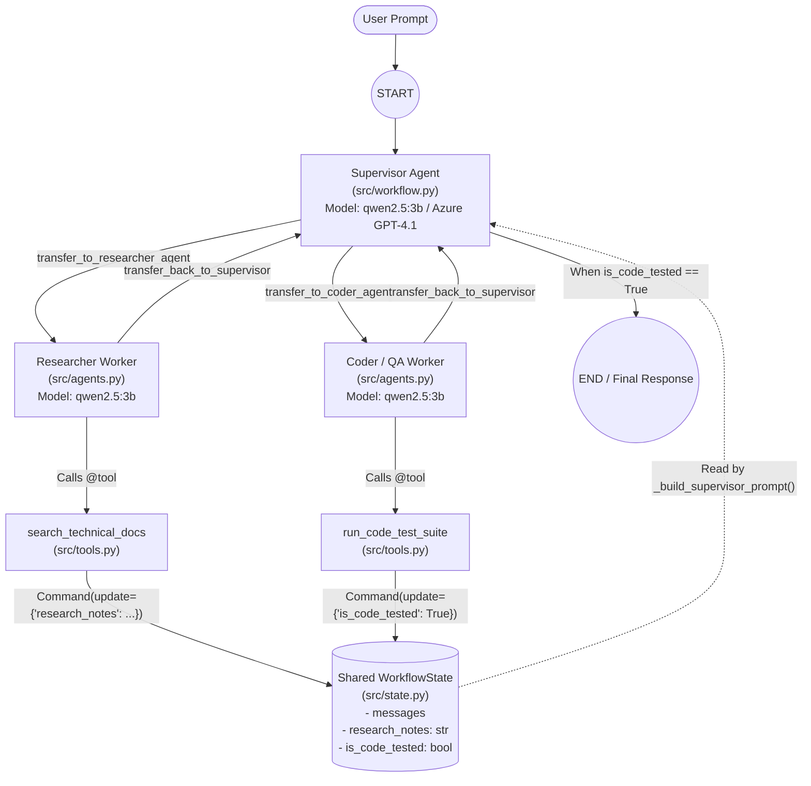
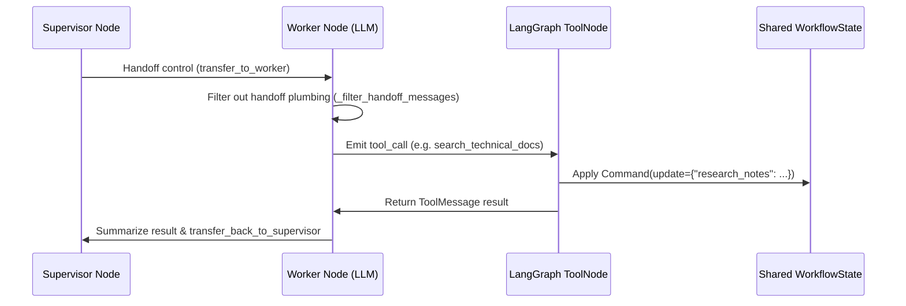

# LangGraph Multi-Agent Architecture & Capabilities Guide

This document explains how the **Supervisor-Worker Multi-Agent Architecture** in [langgraph-multi-agent](file:///home/s/code/langgraph-multi-agent) works under the hood, what **LangGraph** does at each step, and what the current setup is capable of.

---

## 1. High-Level Architecture Topology

---

## 2. What LangGraph Is Doing Behind the Scenes

An LLM (`qwen2.5:3b` on Ollama or `gpt-4.1` on Azure) is stateless: on any single call, it only predicts the next message or tool call. **LangGraph** provides the **stateful runtime engine** that turns independent LLM calls into a coordinated system:

### A. Central Shared Memory ([`WorkflowState`](file:///home/s/code/langgraph-multi-agent/src/state.py#L7-L19))
LangGraph maintains a persistent typed dictionary across all nodes in the graph:
- `messages`: Appends user prompts, agent responses, and tool outputs using LangGraph's `add_messages` reducer.
- `research_notes` (`str`): Written by the Researcher's tool and read by the Supervisor and Coder.
- `is_code_tested` (`bool`): Written by the Coder's test runner tool and checked by the Supervisor as a completion gate.

### B. ReAct Execution Loops Inside Each Worker ([`src/agents.py`](file:///home/s/code/langgraph-multi-agent/src/agents.py))
Each worker is built with [`create_react_agent()`](file:///home/s/code/langgraph-multi-agent/src/agents.py#L33-L65), which compiles an isolated mini-state-machine:

### C. Strict Tool Scoping & Guardrails ([`src/tools.py`](file:///home/s/code/langgraph-multi-agent/src/tools.py))
- **Supervisor (`supervisor`)**: Has **zero** raw execution tools. It only receives `transfer_to_researcher_agent` and `transfer_to_coder_agent`.
- **Researcher (`researcher_agent`)**: Only has [`search_technical_docs`](file:///home/s/code/langgraph-multi-agent/src/tools.py#L17-L59) bound to its model.
- **Coder (`coder_agent`)**: Only has [`run_code_test_suite`](file:///home/s/code/langgraph-multi-agent/src/tools.py#L66-L84) bound to its model.

---

## 3. What Is the Current Setup Capable Of?

### Current Out-of-the-Box Capabilities
1. **100% Offline Multi-Agent Orchestration**: Runs end-to-end on your Mini PC's 2-core/4-thread Intel Pentium Gold 7505 CPU using `qwen2.5:3b` via Ollama (`http://localhost:11434/v1`).
2. **Hybrid Cloud + Local Switching**: Can switch either the Supervisor or Workers between Local Ollama (`qwen2.5:3b`) and Azure OpenAI (`gpt-4.1`) strictly via [.env](file:///home/s/code/langgraph-multi-agent/.env) without changing any code.
3. **Deterministic State Gating**: Enforces a multi-stage workflow where research (`research_notes`) must occur before coding/testing (`is_code_tested = True`), and the Supervisor cannot finish until `is_code_tested` is verified.
4. **Offline Simulation Mode (`--demo`)**: Includes [`DemoScriptedChatModel`](file:///home/s/code/langgraph-multi-agent/main.py#L20-L115) in [main.py](file:///home/s/code/langgraph-multi-agent/main.py) to test graph topology and state transitions in `<0.2s` without calling an LLM.

### What Is Simulated vs. How to Make It Do Real Work
Right now, the two tools in [src/tools.py](file:///home/s/code/langgraph-multi-agent/src/tools.py) use **mock/in-memory implementations** so you can safely test the architecture:
- [`search_technical_docs`](file:///home/s/code/langgraph-multi-agent/src/tools.py#L17-L59) searches an in-memory dictionary.
- [`run_code_test_suite`](file:///home/s/code/langgraph-multi-agent/src/tools.py#L66-L84) returns a simulated `pytest` pass report and flips `is_code_tested = True`.

> [!TIP]
> **Upgrading to Real Execution:** Because LangGraph tools are just standard Python functions decorated with `@tool`, you can upgrade this skeleton into a production system by:
> - Replacing the dictionary in [`search_technical_docs`](file:///home/s/code/langgraph-multi-agent/src/tools.py#L17-L59) with a real documentation reader, vector DB query, or web search API.
> - Replacing [`run_code_test_suite`](file:///home/s/code/langgraph-multi-agent/src/tools.py#L66-L84) with `subprocess.run(["pytest", module_name], capture_output=True, text=True)` and setting `is_code_tested = (proc.returncode == 0)`.
> - Adding new worker agents in [src/agents.py](file:///home/s/code/langgraph-multi-agent/src/agents.py) and passing them into `agents=[...]` in [`create_multi_agent_graph()`](file:///home/s/code/langgraph-multi-agent/src/workflow.py#L46-L61).
